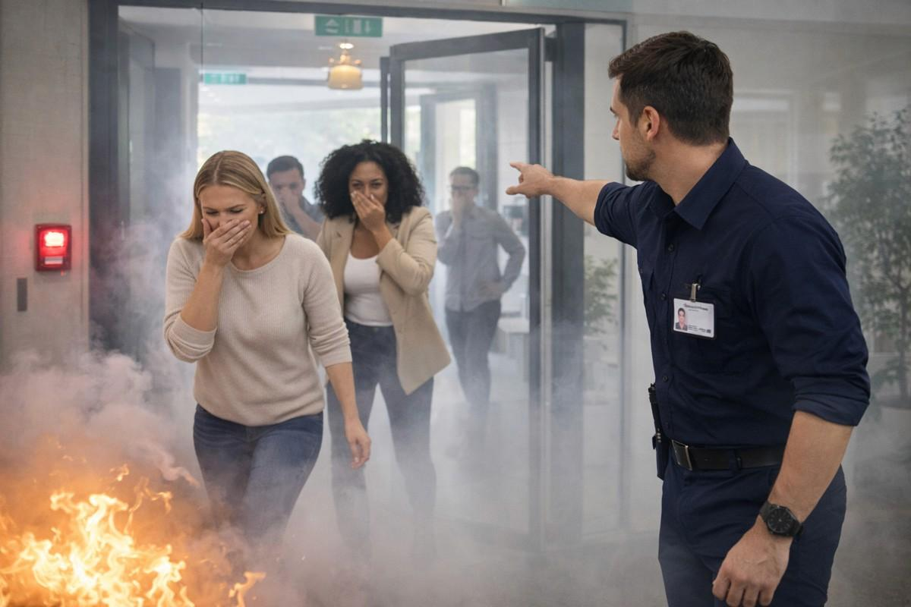
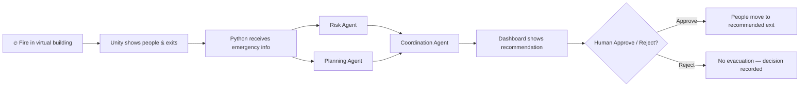
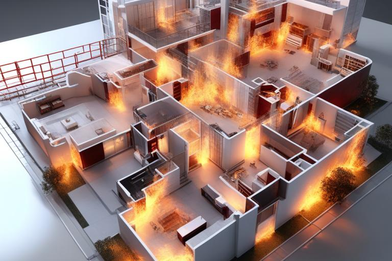
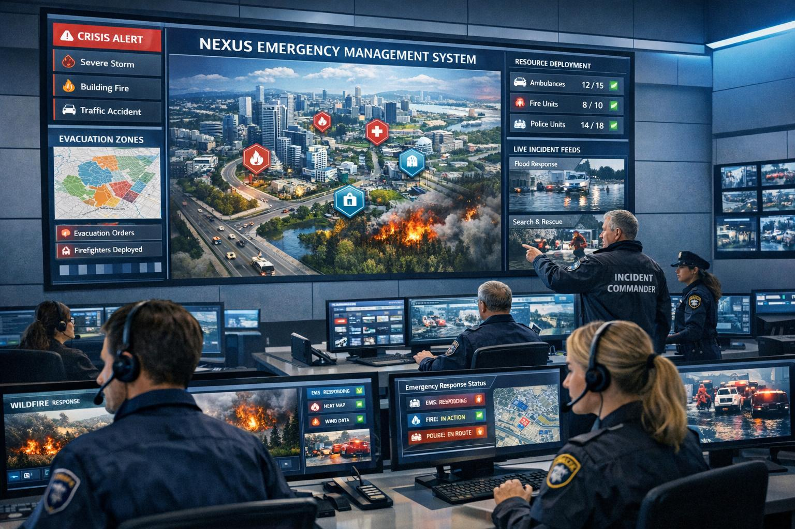

# EmergencyAI Simulator

**AI-Assisted Emergency Decision Support**

> A virtual emergency control system where multiple AI agents help a human operator make evacuation decisions — not a fire game.


---

## What problem does this solve?

Imagine a fire breaks out inside a large building — a shopping mall, hospital, university, or office.

People are inside. Some exits may be blocked by fire or smoke. An emergency operator needs to understand the situation quickly and decide how people should evacuate.

**EmergencyAI Simulator** is a small simulated version of that situation. It shows how AI can *assist* decision-making — while a human stays in control.



### Example scenario

| Situation | In the simulation |
| --- | --- |
| 10 people inside a building | Blue NPC characters |
| Fire starts in Room 2 | Visible fire hazard |
| Exit B becomes unavailable | Blocked / red exit |
| Exit A is still available | Usable / green exit |
| Operator must decide what to do | Approve or Reject on the dashboard |

---

## How the project works (simple view)

Think of **three AI assistants** working together:

1. **Risk Assessment Agent** — checks fire severity, number of people, and exits → e.g. **HIGH RISK**
2. **Evacuation Planning Agent** — checks which exits are usable → e.g. **Use Exit A**
3. **Coordination Agent** — combines both into one clear recommendation for the operator

They work through a Python backend. Unity shows the building and the dashboard.



**Remember the whole project in one sentence:**

> Fire happens in a virtual building → AI agents assess risk and recommend an exit → a human approves or rejects → the simulation shows the outcome.

---

## What does the user actually see?

When someone opens the application, they see a **3D building** and a **control dashboard**.



On screen they can see:

- Rooms and corridors  
- People represented by 3D characters  
- Fire locations  
- Emergency exits  
- People moving during evacuation  
- Live counts (occupants / evacuated / remaining)  
- AI recommendation with **Approve** / **Reject**

### Example dashboard message (illustrative)

```text
Emergency Alert — HIGH RISK
Fire detected – Room 2

AI-generated decision support
- Fire severity: 8/10
- Total occupants: 10
- Available exits: Exit A
- Blocked exits: Exit B

Recommended action
Direct simulated occupants towards Exit A.

Reason: Exit B is unavailable, while Exit A remains available.

Waiting for human approval
[ Approve ]   [ Reject ]
```

If the operator **approves**, people in the simulation move toward the recommended exit.  
If they **reject**, the recommendation is recorded and automatic evacuation does not start.

---

## How this relates to real life



| In your simulation | Possible real-world equivalent |
| --- | --- |
| Simulated building | Office, hospital, shopping mall |
| Virtual people | Building occupants |
| Simulated fire | Fire detection information |
| Blocked exit | Unavailable evacuation route |
| Risk assessment agent | Emergency risk analysis |
| Evacuation planning agent | Evacuation decision support |
| Human operator | Emergency manager / incident commander |


In a real deployment, information could come from fire alarms, smoke detectors, cameras, building sensors, and emergency personnel.

**This prototype uses simulated information only.**  
It does **not** connect to real fire alarms and does **not** control real evacuations.

---

## Why this matters (research angle)

This project demonstrates:

- **Agentic AI** — specialised agents collaborate on one emergency  
- **Decision support** — AI recommends actions, not just text  
- **Human–AI interaction** — a human reviews and controls important decisions  
- **Simulation** — a virtual environment to safely test scenarios  
- **Software integration** — the 3D front end and AI backend talk over an API  

It aligns with research on **Human-Centric Agentic AI for Emergency Decision Support**.

---

## Project folder structure (what each part means)

```text
EmergencyAI-Simulator/
│
├── unity/                 → What the user sees (3D building + dashboard)
│   └── Assets/
│       ├── Scenes/        → Game/simulation scenes
│       ├── Scripts/
│       │   ├── Core/      → Starts and manages the overall simulation
│       │   ├── Modules/
│       │   │   ├── Environment/   → Building, fire, exits
│       │   │   ├── Evacuation/    → People and movement
│       │   │   ├── Emergency/     → Recommendation & decision data
│       │   │   └── Dashboard/     → On-screen control centre UI
│       │   ├── Networking/ → Sends emergency info to Python / receives AI reply
│       │   └── Shared/     → Shared helpers
│       ├── Prefabs/       → Reusable 3D objects
│       ├── Materials/     → Visual materials
│       └── UI/            → Extra UI assets
│
├── backend/               → The AI “brain” (Python)
│   ├── app/
│   │   ├── main.py        → Starts the web API
│   │   ├── core/          → Settings and shared errors
│   │   ├── api/           → Top-level API wiring
│   │   ├── middlewares/   → Cross-cutting HTTP setup (e.g. CORS)
│   │   └── modules/
│   │       ├── emergency/         → Receives Unity’s emergency request
│   │       ├── risk_assessment/   → Risk Assessment Agent
│   │       ├── evacuation/        → Evacuation Planning Agent
│   │       └── coordination/      → Coordination Agent
│   └── tests/             → Automated checks for agents and API
│
├── docs/                  → Project explanations and plans
│   ├── image/             → Concept / demo images used in this README
│   ├── PROJECT_SPEC.md    → What we are building
│   ├── ARCHITECTURE.md    → How parts communicate
│   ├── AGENT_DESIGN.md    → What each AI agent does
│   ├── DEVELOPMENT_PLAN.md→ Step-by-step build prompts
│   └── TEST_PLAN.md       → How to test T1–T11
│
├── evidence/              → Screenshots / demo evidence (for reports)
├── reports/               → Written reports / evaluation notes
│
├── AGENTS.md              → Rules for AI coding assistants working on this repo
├── TASKS.md               → Checklist of development tasks
├── README.md              → This file (project story + overview)
└── .gitignore             → Files not uploaded to Git
```

### Short meaning of key docs

| File | Meaning |
| --- | --- |
| `AGENTS.md` | How coding agents should work on this project |
| `TASKS.md` | What is done / still to do |
| `docs/PROJECT_SPEC.md` | Product goals and MVP success criteria |
| `docs/ARCHITECTURE.md` | System design (Unity ↔ FastAPI ↔ agents) |
| `docs/AGENT_DESIGN.md` | Responsibilities of each AI agent |
| `docs/TEST_PLAN.md` | Component → full-system testing checklist |

---

## Important disclaimer

This is an **academic research prototype** for demonstration and learning.

It must **not** be presented as a validated fire-safety or emergency-response system.

---

## Quick start (when you want to run it)

**1. AI backend**

```powershell
cd backend
python -m venv .venv
.\.venv\Scripts\Activate.ps1
pip install -r requirements.txt
uvicorn app.main:app --reload --host 127.0.0.1 --port 8000
```

Open API docs: http://127.0.0.1:8000/docs

**2. Unity front end**

1. Install Unity Hub + a Unity Editor (3D template)  
2. Open / create the project under `unity/`  
3. Press **Play**  
4. Dashboard: Trigger Emergency → Request AI Analysis → Approve / Reject  

More detail: [`unity/UNITY_SETUP.md`](unity/UNITY_SETUP.md) · [`docs/TEST_PLAN.md`](docs/TEST_PLAN.md)

---

## License / use

Intended for research, coursework, and demonstration.  
Not for operational emergency deployment.
